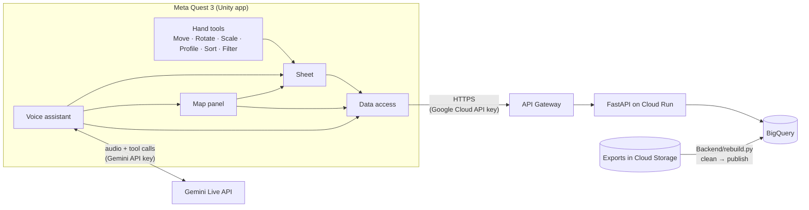

# Architecture

How the headset app, the voice assistant and the data API fit together, where each lives in
this repository, and how changes to the API ship.

## Overview



## Repository layout

| Path | What it holds |
|---|---|
| `Assets/Source/` | The app's C# code: map, sheet, hand tools, UI, data access and the assistant |
| `Assets/Scenes/Main.unity` | The app's one scene |
| `Backend/` | Data cleaning, the API, its tests and deploy scripts (see [`Backend/README.md`](../Backend/README.md)) |
| `cloudbuild.yaml` | Cloud Build: tests every push, deploys `main` |
| `.github/workflows/` | GitHub Actions: the tests that need no Google Cloud access |

## Changing the breach database API

The API under `Backend/` ships itself. Cloud Build watches this repository and runs
`cloudbuild.yaml` on every push:

```
push to any branch:  run the tests
merge to main:       run the tests --> build the Docker image --> deploy to Cloud Run --> check it answers
```

A failing test stops the build, so nothing untested reaches the headsets, and the live
version is always tagged with the commit it came from. Builds and their logs are in the
Google Cloud console under **Cloud Build → History** (region `us-east1`).
[`Backend/README.md`](../Backend/README.md) covers what the CI pipeline may and may not touch, and the changes that
still go through `deploy.sh` by hand.

GitHub Actions also runs the backend tests that need no Google Cloud access on every
push and pull request, so their result shows on GitHub.
